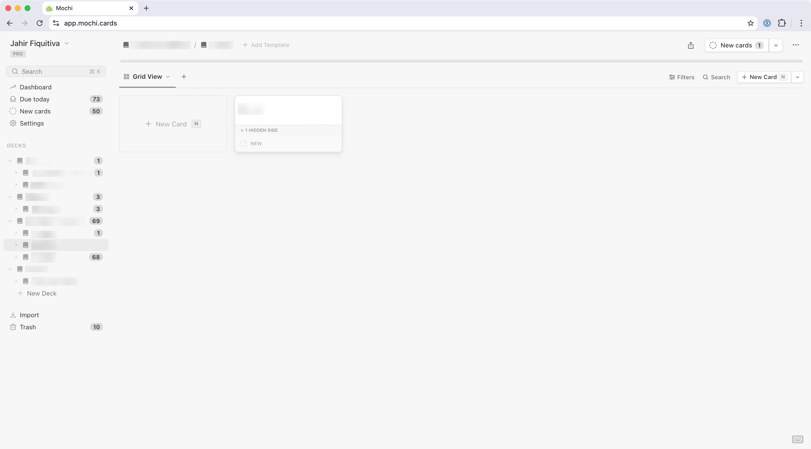
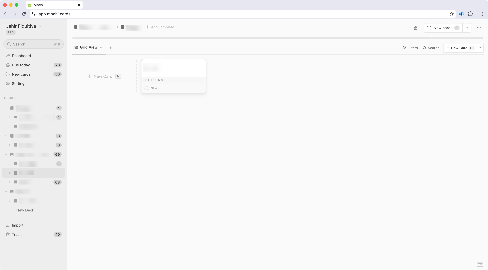
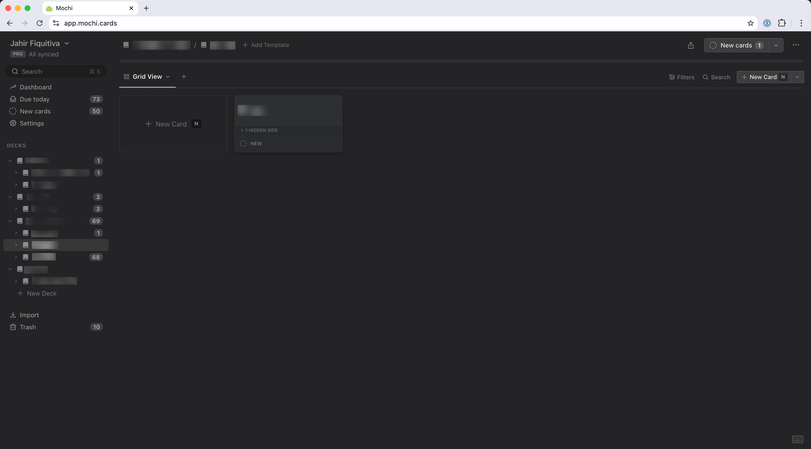
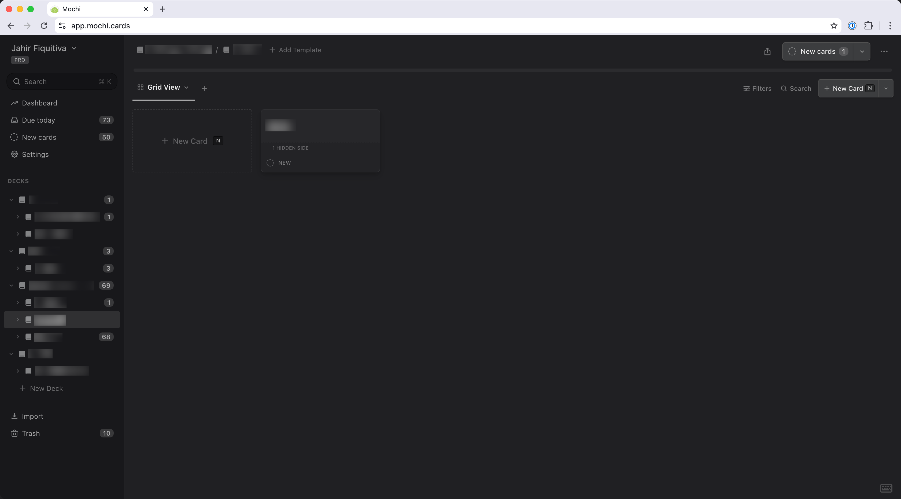

# Clean Theme for [Mochi](https://mochi.cards/)

Minor tweaks to make [Mochi](https://mochi.cards/) easier to use and have a slightly cleaner look.

## Features

- Distinct colors for sidebar and content
- Bigger touch targets and sidebar items
- Divider border for sidebar

## Installation

1. Download the [`mochi-clean-theme.css`]() file.
2. Navigate to Mochi's Settings
3. Select "Appearance" on the sidebar
4. Find the "Custom CSS theme" section
5. Press the "Add theme" button
6. Select the downloaded css file

> [!NOTE]
> You need to redo the steps above every time you update the theme file

## Preview

### Light Theme

| Before 😕 | After 🤩 |
| ------- | ------- |
|  |  |

### Dark Theme

| Before 😕 | After 🤩 |
| ------- | ------- |
|  |  |

## Contributing

You're welcome to fork and modify this theme to suit your needs! However, I'd love it if you considered opening a pull request to share your improvements with the community, rather than keeping them in your fork alone.

Just a heads up: I'm quite selective about what gets merged. I want to keep the theme cohesive, so I'll only accept changes that align with its vision and that I feel would enhance the experience for most users.

Thank you for understanding! 🙏
